# ✏️ Apuntes en LaTeX

> Librería de estilos para apuntes: apartados, secciones, párrafos, cajas,
> tarjetas, viñetas, tablas y pies de página, todo con colores automáticos.
> Se **descarga de GitHub al compilar**, así que siempre tienes la última
> versión. Compila con **XeLaTeX** y `-shell-escape` (ya configurado en VS Code).

## 📋 Todo lo que puedes usar

### 📥 Carga

| | | Código |
|---|---|---|
| **Carga** | 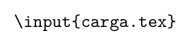 | |
| | | `\input{carga.tex}` |

### 🎨 Paletas

| | | Código |
|---|---|---|
| **Paleta Amarillo** |  | |
| | | `\paletaAmarillo` |
| **Paleta Arena** |  | |
| | | `\paletaArena` |
| **Paleta Azul** | 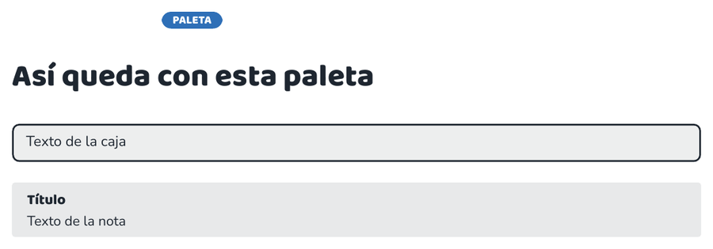 | |
| | | `\paletaAzul` |
| **Paleta Bosque** |  | |
| | | `\paletaBosque` |
| **Paleta Burdeos** |  | |
| | | `\paletaBurdeos` |
| **Paleta Cafe** |  | |
| | | `\paletaCafe` |
| **Paleta Celeste** |  | |
| | | `\paletaCeleste` |
| **Paleta Ciruela** |  | |
| | | `\paletaCiruela` |
| **Paleta Coral** |  | |
| | | `\paletaCoral` |
| **Paleta Fucsia** | 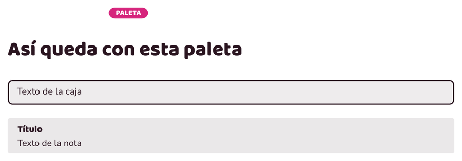 | |
| | | `\paletaFucsia` |
| **Paleta Gris** |  | |
| | | `\paletaGris` |
| **Paleta Lavanda** |  | |
| | | `\paletaLavanda` |
| **Paleta Lila** | 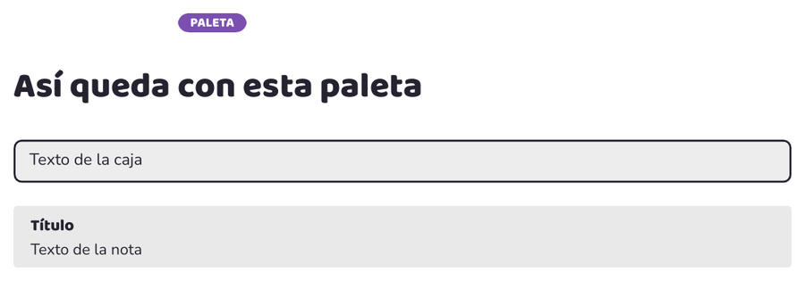 | |
| | | `\paletaLila` |
| **Paleta Lima** |  | |
| | | `\paletaLima` |
| **Paleta Melocoton** | 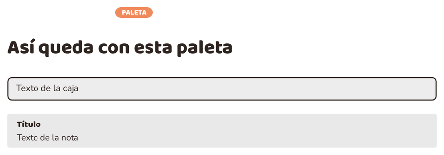 | |
| | | `\paletaMelocoton` |
| **Paleta Menta** |  | |
| | | `\paletaMenta` |
| **Paleta Naranja** |  | |
| | | `\paletaNaranja` |
| **Paleta Oceano** | 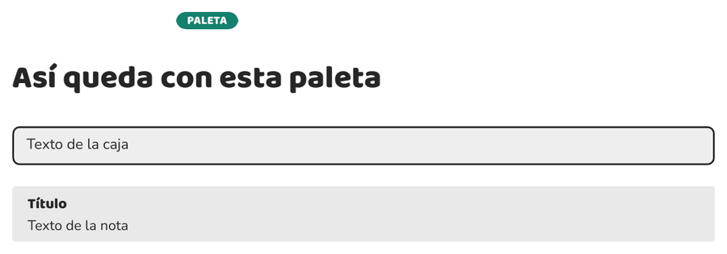 | |
| | | `\paletaOceano` |
| **Paleta Oliva** | 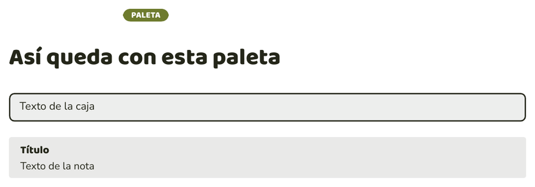 | |
| | | `\paletaOliva` |
| **Paleta Rojo** | 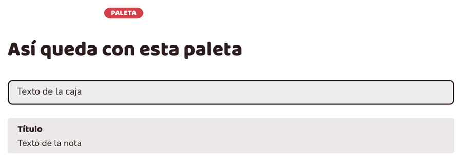 | |
| | | `\paletaRojo` |
| **Paleta Rosa** | 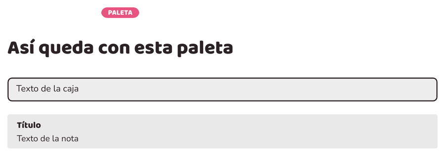 | |
| | | `\paletaRosa` |
| **Paleta Turquesa** | 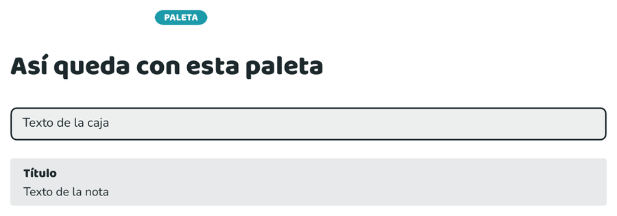 | |
| | | `\paletaTurquesa` |

### 🌈 Colores

| | | Código |
|---|---|---|
| **Tu propio color** | 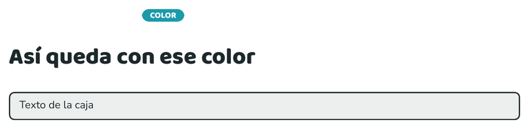 | |
| | | `\mipaleta{#E75480}{#B23A63}{#2B2226}` |
| **Forzar color** |  | |
| | | `\colorapartado{rosaA}` |

### 🏷️ Títulos

| | | Código |
|---|---|---|
| **Apartado** |  | |
| | | `\titulo{ETIQUETA}{Título}` |
| **Sección** |  | |
| | | `\seccion{Título de sección}` |
| **Sección grande** |  | |
| | | `\secciongrande{Título de sección}` |
| **Título A** |  | |
| | | `\tituloA{Texto}` |
| **Título B** |  | |
| | | `\tituloB{Texto}` |
| **Título C** |  | |
| | | `\tituloC{Texto}` |
| **Título D** |  | |
| | | `\tituloD{Texto}` |
| **Título E** |  | |
| | | `\tituloE{Texto}` |
| **Título F** |  | |
| | | `\tituloF{Texto}` |
| **Título G** |  | |
| | | `\tituloG{Texto}` |
| **Título H** |  | |
| | | `\tituloH{Texto}` |
| **Título I** |  | |
| | | `\tituloI{Texto}` |
| **Título J** |  | |
| | | `\tituloJ{Texto}` |
| **Título K** | 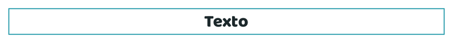 | |
| | | `\tituloK{Texto}` |
| **Título L** | 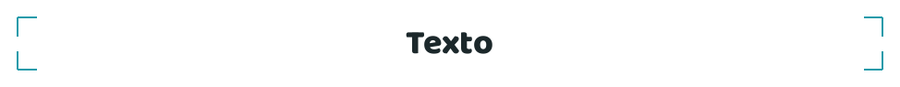 | |
| | | `\tituloL{Texto}` |
| **Título M** |  | |
| | | `\tituloM{Texto}` |
| **Título N** |  | |
| | | `\tituloN{Texto}` |
| **Título O** |  | |
| | | `\tituloO{Texto}` |
| **Título P** | 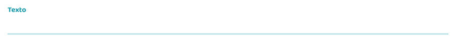 | |
| | | `\tituloP{Texto}` |
| **Título Q** | 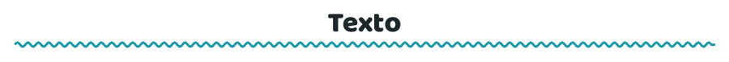 | |
| | | `\tituloQ{Texto}` |

### ✏️ Párrafos y texto

| | | Código |
|---|---|---|
| **Párrafo** |  | |
| | | `\parrafo{Texto del párrafo con **negrita** y \hl{resaltado}.}` |
| **Resaltado** |  | |
| | | `\hl{Texto resaltado}` |
| **Resalta** |  | |
| | | `\resalta{Texto resaltado}` |

### 📦 Cajas

| | | Código |
|---|---|---|
| **Caja** | 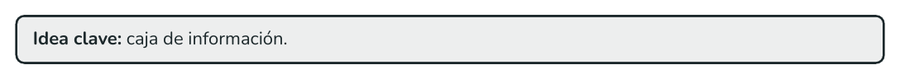 | |
| | | `\caja{**Idea clave:** caja de información.}` |
| **Dos cajas** | 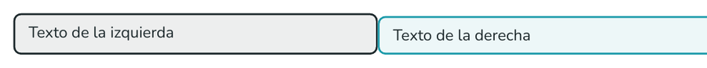 | |
| | | `\cajadual{Texto de la izquierda}{Texto de la derecha}` |
| **Nota** |  | |
| | | `\nota{Para el examen}{Caja de nota con borde de color.}` |
| **Dato** |  | |
| | | `\dato{2024}{Dato destacado}` |
| **Resumen** |  | |
| | | `\resumen{**Resumen:** la única caja con el color pleno del apartado.}` |
| **Píldora** |  | |
| | | `\pill{Etiqueta}` |

### 🃏 Tarjetas

| | | Código |
|---|---|---|
| **Tarjeta** | 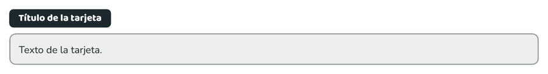 | |
| | | `\definicion{Título de la tarjeta}{Texto de la tarjeta.}` |
| **Tarjeta compacta** |  | |
| | | `\definicionpar{Título de la tarjeta}{Texto de la tarjeta.}` |
| **Dos tarjetas en fila** | 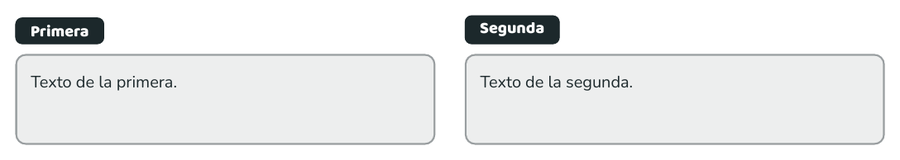 | |
| | | `\rectangulosdoble{Primera}{Texto de la primera.}{Segunda}{Texto de la segunda.}` |
| **Cuatro tarjetas en fila** |  | |
| | | `\rectangulos{{Una}{Texto de la primera.}{Dos}{Texto de la segunda.}{Tres}{Texto de la tercera.}{Cuatro}{Texto de la cuarta.}}` |

### 🔸 Viñetas y listas

| | | Código |
|---|---|---|
| **Lista** |  | |
| | | `\lista{**Negrita** en el item.\|Otro item.\|Un último item.}` |
| **Viñeta de rombo** |  | |
| | | `\marcas{Uno\|Dos\|Tres}` |
| **Casillas de tarea** |  | |
| | | `\tareas{Tarea 1.\|Tarea 2.}` |
| **Pasos numerados** | 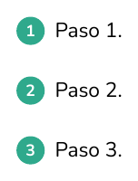 | |
| | | `\pasos{Paso 1.\|Paso 2.\|Paso 3.}` |
| **Estrella** |  | |
| | | `\estrellas{Idea clave para el examen}` |
| **Aviso** | 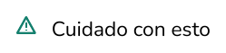 | |
| | | `\alertas{Cuidado con esto}` |
| **Pregunta** | 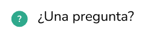 | |
| | | `\preguntas{¿Una pregunta?}` |
| **Flechas** |  | |
| | | `\flechas{Flecha 1\|Flecha 2}` |

### 📊 Tablas

| | | Código |
|---|---|---|
| **Tabla simple** |  | |
| | | `\begin{tablaminimal}{lcc}
  \tablacab{Técnica} & \tablacab{Resolución} \\
  \midrule
  fMRI & Espacial alta \\
\end{tablaminimal}` |
| **Tabla con cabecera** | 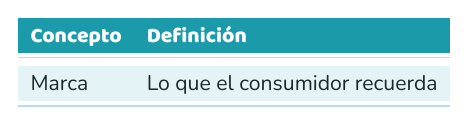 | |
| | | `\begin{tablacabecera}{ll}
  \rowcolor{primary}
  \tablacabb{Concepto} & \tablacabb{Definición} \\
  \midrule
  Marca & Lo que el consumidor recuerda \\
\end{tablacabecera}` |
| **Tabla con rejilla** |  | |
| | | `\begin{tablacuadricula}{\|l\|c\|}
  \tablacab{Producto} & \tablacab{Precio} \\ \hline
  Manzana & 1,20€ \\ \hline
\end{tablacuadricula}` |
| **Ficha de clave** | 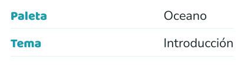 | |
| | | `\begin{fichaclave}{4cm}
  \fichaitem{Paleta}{Oceano}
  \fichaitem{Tema}{Introducción}
\end{fichaclave}` |
| **Sí y no** |  | |
| | | `\si\ \no` |

### 🖼️ Filas con foto

| | | Código |
|---|---|---|
| **Fila con foto** | 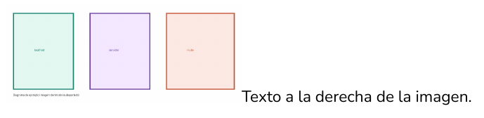 | |
| | | `\filaimagen{0.32\linewidth}{imagenes/ejemplo.png}{Texto a la derecha de la imagen.}` |
| **Fila con foto a la derecha** | 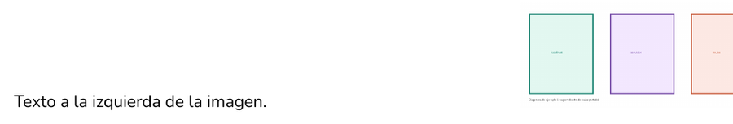 | |
| | | `\filaimagender{0.32\linewidth}{imagenes/ejemplo.png}{Texto a la izquierda de la imagen.}` |
| **Fila de dos textos** |  | |
| | | `\filacontenido{0.4\linewidth}{Contenido de la izquierda.}{Contenido de la derecha.}` |

### ✨ Fondo y otros

| | | Código |
|---|---|---|
| **Emojis y símbolos** |  | |
| | | `\caja{🌐 Web  📚 Apuntes  ✅ Hecho  ⚠️ Cuidado  ★ Destacado  ♥ Importante}` |
| **Fondo de página** |  | |
| | | `\usarfondo` |
| **Pie de página** |  | |
| | | `\pagefoot{Apuntes -- Tema 01}` |

### 🧰 Utilidades

| | | Código |
|---|---|---|
| **Entrada de carpeta** |  | |
| | | `\inputcarpeta{Tema2.1}` |
| **Enlazar un archivo** |  | |
| | | `\input{temas/Tema2.1/1.1-apartado.tex}` |

Cada cosa va en **dos filas**: una con la captura de cómo se ve y la
siguiente con el código que copias. Las secciones son las mismas carpetas
en las que está divided la librería (`bibliotecas_latex/estilo/`).

%s

### 🎨 Los colores de cada bloque

- El **apartado** (y solo él) lleva el color **pleno** de su paleta.
- Las **cajas** (caja, nota, dato) y las **tarjetas** llevan un color
  **neutro**: nunca toman la paleta del título, para que no se confundan.
- El **`\resumen`** sí lleva el color pleno del apartado, con su sombra.

### 🖼️ Todos los códigos, de golpe


## 📂 Cómo se ordenan tus apuntes

```
apuntes/
  Tema 2/                     <- la asignatura (una carpeta por asignatura)
    tema2.tex                 <- el documento que une TODOS sus apartados
    carga.tex                 <- descarga la librería de GitHub y la enlaza
    Tema2.1/                  <- un tema (una carpeta por tema)
      1.1-apartado.tex        <- los apartados, numerados (1.1, 1.2...)
      1.2-apartado.tex
      imagenes/               <- las imágenes de este tema
    Tema2.2/                  <- el siguiente tema
      2.1-apartado.tex
```

La numeración es la académica: **TEMA 2 → TEMA 2.1 → apartado 1.1**, y el
número va en el nombre del archivo. Si un apartado tiene varias partes, se
puede partir en `1.1.1`, `1.1.2`… (cada uno en su propio archivo).

Para unir los apartados de un tema no hace falta escribir un `\input` por
cada archivo: **`\inputcarpeta`** mete todos los `.tex` de una carpeta (y de
sus subcarpetas) en orden:

```latex
\inputcarpeta{{Tema2.1}}      % mete 1.1, 1.2... de golpe
```

Las rutas se cuentan **desde la raíz del documento** (la carpeta donde
compilas). En la carpeta `ejemplo/` tienes un ejemplo completo:

```
ejemplo/
  carga.tex
  temas.tex                          <- el documento principal
  apuntes/
    asignatura/
      Temas.tex                      <- la asignatura
      Tema X/                        <- un tema
        Tema X.X/                    <- sus apartados (1.1, 1.2...)
          1.1-apartado.tex
          1.2-apartado.tex
          imagenes/
```

## 🧩 La librería de estilos, dividida

`bibliotecas_latex/estilo.tex` es solo el **cargador**: cada cosa está en
su propio archivo dentro de `bibliotecas_latex/estilo/`.

```
estilo/
  carga/       paquetes, fuentes, emojis
  paletas/     24 paletas (una por archivo)
  colores/     variables, paleta propia, pool de secciones, color actual
  titulos/     un archivo por estilo de título (A-Q) + titulo, seccion
  parrafos/    realce, resaltado, parrafo, resalta
  cajas/       un archivo por caja (caja, nota, dato, resumen...)
  tarjetas/    un archivo por tarjeta (typecard, definicion, rectangulos)
  vinetas/     un archivo por tipo de viñeta
  tablas/      un archivo por tipo de tabla
  filas/       un archivo por tipo de fila
  fondo/       fondo de página, usarfondo, pie
  utilidades/  \inputcarpeta (entrada de carpetas)
```

`bibliotecas_latex/cabecera.tex` es la **plantilla aparte**: contiene la
carga de la librería, el español y la limpieza al terminar. Cada documento
solo hace `\input{{carga.tex}}` (la copia local) o enlaza la cabecera
descargada.

El catálogo completo está en
[`plantilla_apuntes.tex`](plantilla_apuntes.tex) (compílalo para verlo todo)
y las capturas se generan con [`capturas/capturas.tex`](capturas/capturas.tex).
