# ✏️ Apuntes en LaTeX

> Librería de estilos para apuntes: apartados, secciones, párrafos, cajas,
> tarjetas, viñetas, tablas y pies de página, todo con colores automáticos.
> Se **descarga de GitHub al compilar**, así que siempre tienes la última
> versión. Compila con **XeLaTeX** y `-shell-escape` (ya configurado en VS Code).

## 📋 Qué puedes poner y cómo se pone

Una imagen y su código, opción por opción. Lo que está en la columna de la
derecha es **lo que copias**.

| | |
|---|---|
| 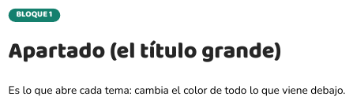 | **Apartado** (el título grande que abre el tema)<br>`\titulo{ETIQUETA}{Título}`<br>`\titulo[rosaA]{ETIQUETA}{Título}` |
| 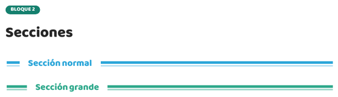 | **Secciones**<br>`\seccion{Título}`<br>`\secciongrande{Título}`<br>`\seccion[rosaA]{Título}` |
| 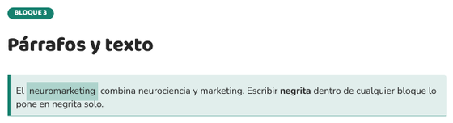 | **Párrafos y texto**<br>`\parrafo{Texto con **negrita** y \hl{resaltado}.}`<br>`\hl{resaltado}` · `\resalta{resaltado}` |
| 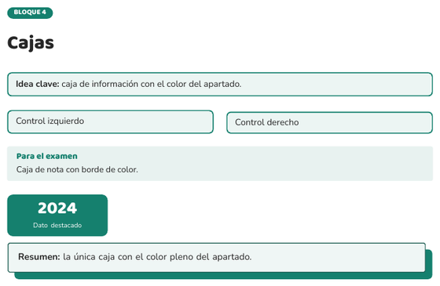 | **Cajas**<br>`\caja{Texto}` · `\cajadual{Texto 1}{Texto 2}`<br>`\nota{Título}{Texto}` · `\dato{Título}{Texto}`<br>`\resumen{Texto}` · `\pill{Etiqueta}` |
| 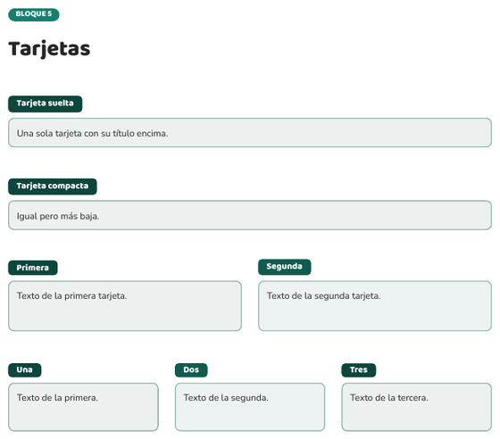 | **Tarjetas**<br>`\definicion{Título}{Texto}` · `\definicionpar{Título}{Texto}`<br>`\rectangulosdoble{T1}{X1}{T2}{X2}`<br>`\rectangulos{{T1}{X1} {T2}{X2} {T3}{X3}}` |
| 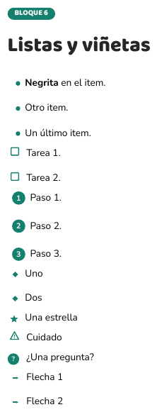 | **Listas y viñetas** (los items se separan con `\|`)<br>`\lista{Uno\|Dos\|Tres}` · `\marcas{...}`<br>`\tareas{...}` · `\pasos{...}`<br>`\estrellas{...}` · `\alertas{...}` · `\preguntas{...}` · `\flechas{...}` |
| 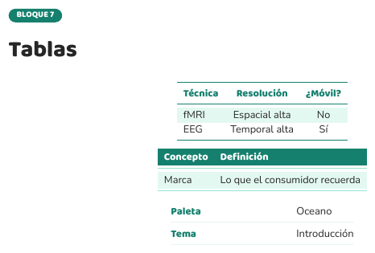 | **Tablas**<br>`\begin{tablaminimal}{ccc} ... \end{tablaminimal}`<br>`\begin{tablacabecera}{cc} ... \end{tablacabecera}`<br>`\begin{fichaclave}{4cm} ... \end{fichaclave}`<br>`\si` · `\no` |
| 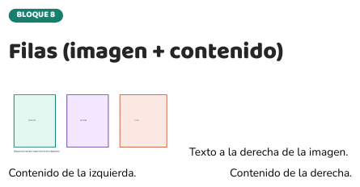 | **Tabla de foto** (filas)<br>`\filaimagen{0.32\linewidth}{imagen}{texto}`<br>`\filaimagender{0.32\linewidth}{imagen}{texto}`<br>`\filacontenido{0.4\linewidth}{izq.}{der.}` |
| 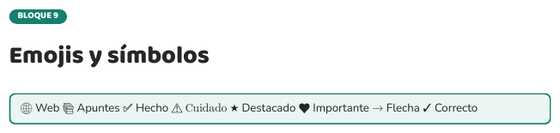 | **Emojis y símbolos** (salen solos, sin envolver nada)<br>`\caja{🌐 Web  📚 Apuntes  ✅ Hecho  ⚠️ Cuidado  ★ Destacado}` |
| 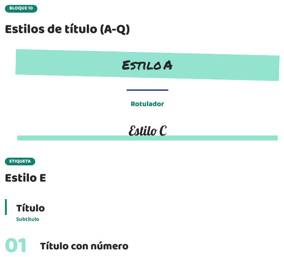 | **Estilos de título** (A-Q), cada uno con su aspecto<br>`\tituloA{...}{...}` · `\tituloB{...}{...}` · `\tituloC{...}` · `\tituloD{...}`<br>`\tituloE{...}{...}` · `\tituloF{...}` · `\tituloG{...}{...}` · `\tituloH{...}` · `\tituloI{...}`<br>`\tituloJ{...}{...}` · `\tituloK{...}` · `\tituloL{...}` · `\tituloM{...}` · `\tituloN{...}`<br>`\tituloO{...}{...}` · `\tituloP{...}{...}` · `\tituloQ{...}` |
| 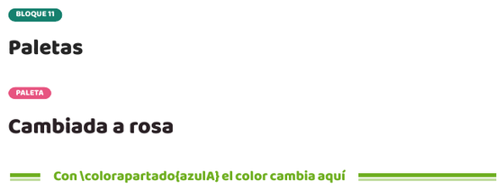 | **Paletas** (el color del apartado)<br>`\paletaOceano` · `\paletaRosa` · `\paletaLavanda` … (24)<br>`\mipaleta{#E75480}{#B23A63}{#2B2226}` (tu color)<br>`\colorapartado{rosaA}` (forzar color) |
| 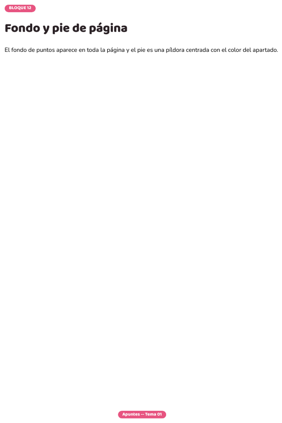 | **Fondo y pie de página**<br>`\usarfondo` · `\pagefoot{Apuntes -- Tema 01}` |

### 🎨 Los colores de cada bloque

- El **apartado** es el único que lleva el color **pleno**.
- Las **cajas** (caja, nota, dato) y las **tarjetas** llevan el **mismo
  color**: un tono del color del apartado.
- Solo el **`\resumen`** lleva el color pleno (y su sombra).

### 🖼️ Todos los códigos, de golpe


## 📂 Cómo se ordenan tus apuntes

```
apuntes/
  Tema 2/                     <- la asignatura (una carpeta por asignatura)
    tema2.tex                 <- el documento que une TODOS sus apartados
    carga.tex                 <- descarga la librería de GitHub y la enlaza
    Tema2.1/                  <- un tema (una carpeta por tema)
      1.1-apartado.tex        <- los apartados, numerados (1.1, 1.2...)
      1.2-apartado.tex
      imagenes/               <- las imágenes de este tema
    Tema2.2/                  <- el siguiente tema
      2.1-apartado.tex
```

La numeración es la académica: **TEMA 2 → TEMA 2.1 → apartado 1.1**, y el
número va en el nombre del archivo. Si un apartado tiene varias partes, se
puede partir en `1.1.1`, `1.1.2`… (cada uno en su propio archivo).

Para unir los apartados de un tema no hace falta escribir un `\input` por
cada archivo: **`\inputcarpeta`** mete todos los `.tex` de una carpeta (y de
sus subcarpetas) en orden:

```latex
\inputcarpeta{Tema2.1}      % mete 1.1, 1.2... de golpe
```

Las rutas se cuentan **desde la raíz del documento** (la carpeta donde
compilas). En la carpeta `ejemplo/` tienes un ejemplo completo:

```
ejemplo/
  carga.tex
  temas.tex                          <- el documento principal
  apuntes/
    asignatura/
      Temas.tex                      <- la asignatura
      Tema X/                        <- un tema
        Tema X.X/                    <- sus apartados (1.1, 1.2...)
          1.1-apartado.tex
          1.2-apartado.tex
          imagenes/
```

## 🧩 La librería de estilos, dividida

`bibliotecas_latex/estilo.tex` es solo el **cargador**: cada cosa está en
su propio archivo dentro de `bibliotecas_latex/estilo/`.

```
estilo/
  carga/       paquetes, fuentes, emojis
  paletas/     24 paletas (una por archivo)
  colores/     variables, paleta propia, pool de secciones, color actual
  titulos/     un archivo por estilo de título (A-Q) + titulo, seccion
  parrafos/    realce, resaltado, parrafo, resalta
  cajas/       un archivo por caja (caja, nota, dato, resumen...)
  tarjetas/    un archivo por tarjeta (typecard, definicion, rectangulos)
  vinetas/     un archivo por tipo de viñeta
  tablas/      un archivo por tipo de tabla
  filas/       un archivo por tipo de fila
  fondo/       fondo de página, usarfondo, pie
  utilidades/  \inputcarpeta (entrada de carpetas)
```

`bibliotecas_latex/cabecera.tex` es la **plantilla aparte**: contiene la
carga de la librería, el español y la limpieza al terminar. Cada documento
solo hace `\input{carga.tex}` (la copia local) o enlaza la cabecera
descargada.

El catálogo completo está en
[`plantilla_apuntes.tex`](plantilla_apuntes.tex) (compílalo para verlo todo)
y las capturas de cada bloque se generan con
[`capturas/capturas.tex`](capturas/capturas.tex).
